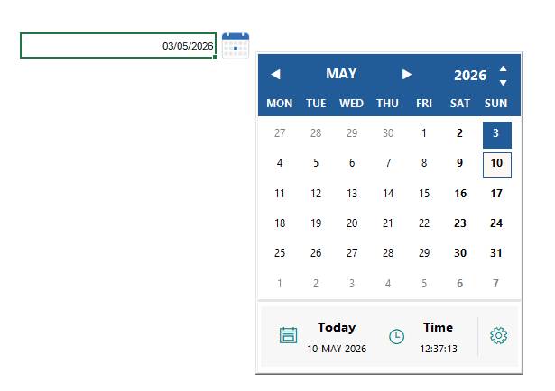
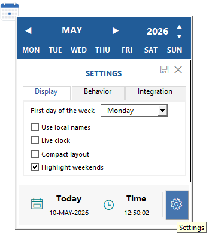
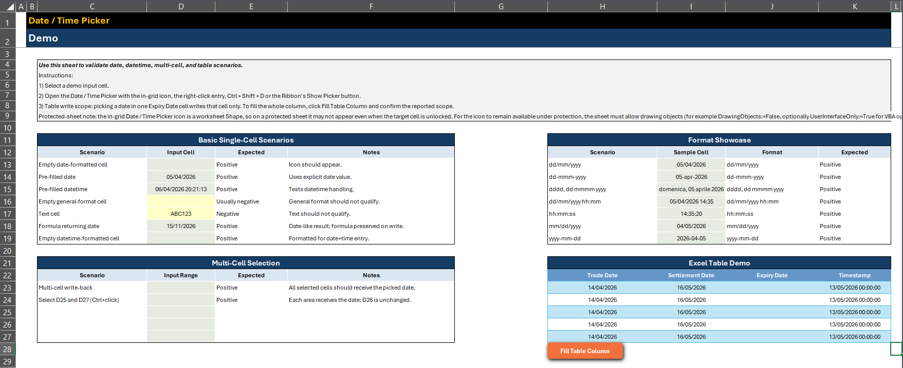

<div align="center">

# 📘 User Manual

### Pick dates and times in Excel with the Date / Time Picker

</div>

---

This manual is for people who **use** the Date / Time Picker in Excel. You do
not need to know VBA. It covers two cases:

- you installed the published add-in (`DATETIMEPICKER.vX.Y.Z.xlam`) from
  [GitHub Releases](https://github.com/danielep71/VBA-DATETIMEPICKER/releases);
- you received a workbook that already contains the picker.

If you build or integrate the picker yourself, read [README.md](../README.md)
and [INSTALLATION.md](../INSTALLATION.md) instead.

> [!NOTE]
> This manual describes the current source, planned for `v1.2.3`. The published
> `v1.2.2` add-in looks slightly different. See
> [Older versions](#older-versions).

## 🧭 Contents

1. [What it is](#what-it-is)
2. [Install the published add-in](#install-the-add-in)
3. [Open the picker](#open-the-picker)
4. [Pick a date and time](#pick-a-date-and-time)
5. [What gets written where](#what-gets-written-where)
6. [Settings](#settings)
7. [The demo sheet](#the-demo-sheet)
8. [Troubleshooting](#troubleshooting)
9. [Get help and report a problem](#get-help)
10. [Older versions](#older-versions)

---

<a id="what-it-is"></a>

## 📅 What it is

The Date / Time Picker is a small calendar window for Excel. You select a cell,
open the picker, and click a day. The date goes into the cell.

<p align="center">
  
</p>

The picker is **modeless**. Excel stays usable while it is open: you can
scroll, select other cells and type as usual.

It runs on desktop Excel for Windows, 32-bit and 64-bit. It needs macros to be
enabled.

---

<a id="install-the-add-in"></a>

## 📦 Install the published add-in

Skip this section if you received a workbook that already contains the picker.
The full steps are in
[INSTALLATION.md](../INSTALLATION.md#-published-add-in-installation). In short:

| Step | What to do | Details |
|---|---|---|
| Download | Open the Releases page and download the `.xlam` asset. Take the exact file name from the release. | [Download and verify](../INSTALLATION.md#download-and-verify) |
| Verify | Compare the file's SHA-256 with the value on the release, for example with `certutil -hashfile "<file name>" SHA256`. Stop if it does not match. | [Download and verify](../INSTALLATION.md#download-and-verify) |
| Unblock | Right-click the file, open **Properties** and tick **Unblock** if Windows shows it. | [Install and enable](../INSTALLATION.md#install-and-enable) |
| Enable | **File → Options → Add-ins**, set **Manage** to **Excel Add-ins**, select **Go…**, **Browse…** to the file and tick it. | [Install and enable](../INSTALLATION.md#install-and-enable) |
| Restart | Close and reopen Excel. | [Install and enable](../INSTALLATION.md#install-and-enable) |
| Check | Find the **Date / Time Picker** group on the **Home** tab, select a date cell and open the picker. | [Validate](../INSTALLATION.md#validate) |

When the add-in loads, it starts the picker for every workbook you open.

**To remove it:** open the same Add-ins dialog and clear the checkbox. Close
Excel, then delete the `.xlam` file. Reopen Excel and check that the Ribbon
group and the right-click entry are gone. See
[Remove](../INSTALLATION.md#remove).

> [!IMPORTANT]
> Run only **one** copy of the picker in Excel at a time. Do not keep the add-in
> loaded while you open a workbook that has the picker built in. See
> [Another copy is already active](#another-copy).

### Does my workbook already contain the picker?

A workbook can carry the picker inside it. Signs that it does:

- it is a macro-enabled file, such as `.xlsm` or `.xlsb`;
- after you enable its macros, right-clicking a cell shows a
  **Date / Time Picker** entry at the top of the menu;
- selecting a date cell shows a small calendar icon next to the cell.

A workbook may show only some of these. The Ribbon group, for example, is
optional. If you are not sure, ask the person who gave you the workbook.

---

<a id="open-the-picker"></a>

## 🖱 Open the picker

There are four ways to open the picker. Each one opens it for the **active
cell**, next to the mouse pointer.

| Entry point | How | Default | Can be turned off |
|---|---|---|---|
| Right-click entry | Right-click a cell and choose **Date / Time Picker**. Works on normal cells and Excel Table cells. | On | Yes, in [Settings](#settings) (**Right-click menu**) |
| In-grid icon | Select a date cell, then click the calendar icon that appears just right of it. | On | Yes, in [Settings](#settings) (**In-grid icon**) |
| Keyboard | Press `Ctrl + Shift + D`. | On | Only by a macro. The settings panel has no option for it. |
| Ribbon | **Home** tab, group **Date / Time Picker**, button **Show Picker**. | Present when the add-in or workbook includes the Ribbon | No |

<p align="center">
  
</p>

**When does the icon appear?** Only when you select **one** cell (a merged cell
counts as one) and that cell:

- holds a date or a date and time, or text that reads as a date; or
- has a date or time number format, even if it is empty.

Cells in **General** or **Text** format with no date in them get no icon. The
right-click entry and the keyboard shortcut work on any cell.

**The Ribbon menu.** The **Show Picker** button has a drop-down part with two
more commands:

| Command | What it does |
|---|---|
| **Reset** | Starts the picker if it is not running, or repairs it if it is. See [Nothing happens](#nothing-happens). |
| **Demo** | Shows or hides the demo sheet. See [The demo sheet](#the-demo-sheet). |

---

<a id="pick-a-date-and-time"></a>

## 🗓 Pick a date and time

### Day view

The picker opens on the month of the date in the active cell. If the cell has
no date, it opens on the current month.

- The day of the cell is filled in blue.
- Today has a blue outline.
- Days from the previous and next month are grey.
- Saturdays and Sundays are bold when **Highlight weekends** is on.

Click a day to write that date into the selection.

Use the header to move around:

| Header control | Action |
|---|---|
| `◀` / `▶` | Previous / next month |
| `▲` / `▼` next to the year | Previous / next year |
| Month name | Open the month view |
| Year | Open the year view |

You can move the picker: drag the blue header by an empty spot.

### Month view

Click the month name, or press `M`. Twelve months appear in a grid. Click one to
return to the day view for that month.

### Year view

Click the year, or press `Y`. Twelve years appear in a grid. While the year view
is open, `▲` and `▼` show the previous or next twelve years. Click a year to
return to the day view for that year. Years from 100 to 9999 are available.

### Today and Time

The footer at the bottom has two buttons:

| Button | Writes | Key |
|---|---|---|
| **Today** (shows today's date) | Today's date | `T` |
| **Time** (shows a clock) | Today's date **and** the current time | `N` |

A day you click, and **Today**, write a date with no time. Only **Time** writes
a time. It always writes the time at the moment you click, even when the clock
in the footer is not live.

> [!NOTE]
> In **Compact layout** the footer is hidden. Use `T` and `N`, and open the
> settings with the gear icon in the header.

### Keyboard

These keys work while the picker window has the focus. Click the picker once if
your keys go to the worksheet instead.

| Key | Action |
|---|---|
| `←` / `→` | Previous / next day |
| `↑` / `↓` | Previous / next week |
| `PageUp` / `PageDown` | Previous / next month |
| `Ctrl + PageUp` / `Ctrl + PageDown` | Previous / next year |
| `Home` / `End` | First / last day of the shown month |
| `Enter` or `Space` | Write the highlighted date |
| `M` | Open the month view |
| `Y` | Open the year view |
| `T` | Write today's date |
| `N` | Write today's date and the current time |
| `Esc` | Close the month view, year view or settings; otherwise close the picker |

`M`, `Y`, `T` and `N` do nothing while you hold `Ctrl` or `Alt`.

While the month view, year view or settings panel is open, `Esc` is the only key
that works. Press it to go back to the day view.

### Closing the picker

The picker closes when:

- you pick a date, or use **Today** or **Time**, while **Close after selection**
  is on (the default);
- you press `Esc` in the day view;
- you select another cell while **Close after selection** is on, or select
  several cells;
- you save or print, or switch to another workbook.

When **Close after selection** is off, the picker stays open after each pick.
It also follows you: select another single cell and it shows that cell's date.

When **Use WinAPI styling** is off, the picker has a normal Windows title bar.
You can then also close it with the title bar's close button.

---

<a id="what-gets-written-where"></a>

## 🎯 What gets written where

The picker writes into the **current selection**, not only the cell you opened
it from.

| You selected | What happens |
|---|---|
| One cell | The value goes into that cell. |
| Several cells | Every selected cell gets the value. |
| Several areas (`Ctrl` + click) | Every cell of every area gets the value. Cells between the areas do not change. |
| One cell in an Excel Table | Only that cell changes. The picker never fills the whole column on its own. |

To write into several cells, select them **first**, then open the picker with
the right-click entry, `Ctrl + Shift + D` or **Show Picker**. The in-grid icon
appears only for single cells.

**Filling a whole Table column** is a separate command. Some workbooks offer a
button for it; the demo sheet has **Fill Table Column**. It asks first, for
example:

```text
Fill 5 cells in tblDatePickerDemo[Expiry Date] with 15-Nov-2026?
```

Answer **No** and nothing changes.

### Cells the picker does not overwrite

| Cell | What happens | Shown in the message as |
|---|---|---|
| Empty | Written | — |
| Holds a value, such as a number, date or text | Overwritten | — |
| Holds a formula, even one that shows a date | **Kept.** The formula is not replaced. | `formula cells preserved` |
| Locked cell on a protected sheet | Skipped | `protected locked` |
| Unlocked cell on a protected sheet | Written | — |
| Part of an array formula | Not changed | `failed` |
| Any other cell Excel refuses to change | Not changed | `failed` |

A formula cell can still **open** the picker: if it shows a date, the picker
starts on that date. Picking a date then leaves the formula alone.

> [!NOTE]
> While the picker writes, it turns off Excel events. A workbook macro that
> normally runs when a cell changes does not run for the picker's write.

### What the messages mean

When some cells were not written, a message titled **Date / Time Picker**
appears. It starts with a count and the range, then one line per reason:

```text
Wrote 2 of 3 cells in Sheet1!D23:D25.

1 formula cells preserved: Sheet1!D24
```

| Line | Meaning |
|---|---|
| `Wrote X of Y cells in <range>.` | `X` cells changed out of `Y` selected. |
| `N protected locked: <cells>` | Locked cells on a protected sheet were skipped. |
| `N formula cells preserved: <cells>` | Formula cells were kept. |
| `N failed: <cells>` | Excel did not accept the value, for example in an array formula. |
| `(N additional classified cells omitted from address list)` | More cells had this outcome than the list shows. The count is still exact. |
| `The operation stopped early after an unexpected error at step "<step>". Any remaining cells were not attempted.` | Something went wrong part way. Cells after that point were not touched. |

Each list names at most 25 cells.

The **Fill Table Column** command has its own messages:

| Message | Meaning |
|---|---|
| `A table data cell is required.` | Select a cell in the Table column you want to fill, then try again. |
| `The fill scope changed after it was described.` | The number of cells filled differs from the number in the question. Check the column. |
| `The table column could not be filled.` | The demo button hit an error. The error number and text follow. |

---

<a id="settings"></a>

## ⚙ Settings

Open the settings panel with the gear icon at the right of the footer. In
**Compact layout**, use the gear icon in the header.

<p align="center">
  
</p>

The panel has three tabs. Change the options, then click the **save** icon
(tooltip "Save settings"). The **×** icon (tooltip "Close settings") closes the
panel **without** saving.

| Tab | Option | What it does | Default |
|---|---|---|---|
| Display | **First day of the week** | `Sunday` or `Monday` starts each calendar row. | Monday |
| Display | **Use local names** | Day and month names in your Windows language. Off: English names. | On |
| Display | **Live clock** | The time in the footer ticks every second. Off: it shows the time when the picker opened. | Off |
| Display | **Compact layout** | A smaller picker without the footer. A gear icon appears in the header. | Off |
| Display | **Highlight weekends** | Saturdays and Sundays in bold. | On |
| Behavior | **Allow outside-month selection** | You can click the grey days of the previous and next month. | On |
| Behavior | **Close after selection** | The picker closes after a pick. Off: it stays open. | On |
| Integration | **Right-click menu** | Shows the **Date / Time Picker** entry in the cell menu. | On |
| Integration | **In-grid icon** | Shows the calendar icon next to date cells. | On |
| Integration | **Use WinAPI styling** | Hides the Windows title bar for a cleaner look. Off: normal title bar. | On |

When you save a change to **Compact layout** or **Use WinAPI styling**, the
picker closes. Open it again to see the new look.

**The keyboard shortcut has no option in the panel.** Saving the panel never
changes it. It can be turned off or on only by a macro; see
[Open from Excel](../README.md#open-from-excel) in the README, or ask the
person who set up your workbook.

### Where settings are kept

Settings are saved in the Windows registry for **your Windows user**, under:

```text
HKEY_CURRENT_USER\Software\VB and VBA Program Settings\VBA_DATETIMEPICKER
```

They are not stored in the workbook. So:

- they follow you to every workbook that uses the picker on this computer;
- another person, or another computer, has its own settings.

A workbook can choose to keep its own separate settings. It then uses a key
named `VBA_DATETIMEPICKER__` followed by a name the workbook chose.

---

<a id="the-demo-sheet"></a>

## 🧪 The demo sheet

The demo sheet lets you try the picker on prepared cells. Open it with
**Home → Date / Time Picker → Demo** (the drop-down part of **Show Picker**).

| Situation | Where the demo sheet goes |
|---|---|
| You opened the demo workbook from the release | Its own demo sheet, kept hidden behind the **Start** sheet until you choose **Demo** |
| The picker is built into the workbook | A sheet in that workbook |
| You use the add-in | The open workbook that already has the demo sheet, or a new workbook |

The sheet is named `DATE PICKER DEMO`. Its title band reads
**Date / Time Picker** / **Demo**. It has four sections:

<p align="center">
  
</p>

| Section | What it shows |
|---|---|
| **Basic Single-Cell Scenarios** | Cells that should and should not get the icon: an empty date cell, a date, a date and time, a General cell, a text cell, a formula `=TODAY()`, an empty date-and-time cell. The **Expected** column says what should happen. |
| **Format Showcase** | Sample cells in seven number formats, from `dd/mm/yyyy` to `yyyy-mm-dd`, including a date-and-time and a time-only format. |
| **Multi-Cell Selection** | Select a range and pick once; or select D25 and D27 with `Ctrl` + click and check that D26 does not change. |
| **Excel Table Demo** | A Table with **Trade Date**, **Settlement Date**, **Expiry Date** and **Timestamp** columns, and a **Fill Table Column** button. |

Green input cells are the ones that should open the picker. **Fill Table
Column** fills the Table column of the selected cell with **today's** date,
after asking you.

**To hide the demo sheet**, click **Demo** again. Click it once more to show it.
The hidden sheet does not appear in Excel's **Unhide** list; use **Demo** to
bring it back. If the demo sheet is the only visible sheet, it stays visible.

---

<a id="troubleshooting"></a>

## 🧯 Troubleshooting

<a id="nothing-happens"></a>

### Nothing happens on right-click or `Ctrl + Shift + D`

Check these in order:

1. **Macros are off.** See [Macros are disabled](#macros-disabled).
2. **The option is off.** Open [Settings](#settings) → **Integration** and check
   **Right-click menu**. The keyboard shortcut may have been turned off by a
   macro.
3. **The picker is not running.** Click **Home → Date / Time Picker → Reset**.
   If no copy is running, Reset starts it and says:

   ```text
   Date / Time Picker runtime started.
   ```

   If it was running, Reset repairs it and says:

   ```text
   Date / Time Picker runtime repair completed successfully.
   ```

   Repair also helps when another macro has switched off Excel events, which
   stops the icon and the picker from reacting.
4. **Another add-in uses `Ctrl + Shift + D`.** Excel lets only one macro own a
   shortcut key, so another add-in or workbook may have taken it over. Use the
   right-click entry or **Show Picker** instead.

The **Show Picker** button usually still works when the other entry points do
not.

<a id="another-copy"></a>

### "Another copy of the Date / Time Picker is already active"

The full message reads:

```text
Another copy of the Date / Time Picker is already active in this Excel session,
or its ownership could not be verified.
```

Only one copy of the picker may run in one Excel session. Two copies would fight
over the same shortcut, right-click entry and icons. The second copy therefore
refuses to start. The first copy keeps working.

Common causes:

- the add-in is loaded **and** you opened a workbook with the picker built in;
- two workbooks with the picker built in are open;
- the VBA project of the running copy was reset, so it lost track of its
  ownership.

What to do:

1. Close the other copy: close the second workbook, or clear the add-in's
   checkbox in the Add-ins dialog.
2. Save your work and restart Excel. This always clears the conflict.
3. Then click **Reset** in the copy you want to use, if it does not start by
   itself.

**Reset never takes over from another running copy.** If another copy owns the
session, Reset shows the same message.

The message also names a recovery command for when you are sure no other copy
is running. Restarting Excel is the safer choice.

### The icon does not appear

- Select **one** cell. The icon does not appear for a range.
- The cell must hold a date or have a date or time format. General and Text
  cells do not qualify. See [Open the picker](#open-the-picker).
- Check **In-grid icon** in [Settings](#settings).
- On a **protected sheet** the icon may not appear, even for an unlocked cell.
  The icon is a drawing object, and the sheet must allow drawing objects. Use
  the right-click entry or `Ctrl + Shift + D` instead.
- The icon disappears when you save, print, resize the window or switch
  windows. Select the cell again.
- If none of this helps, click **Reset**.

<a id="macros-disabled"></a>

### Macros are disabled

The picker is made of macros. With macros off, there is no right-click entry,
no icon, no shortcut, and the Ribbon buttons cannot work.

- For a **workbook**, enable its macros only if you trust where it came from,
  and follow your organisation's macro policy.
- For the **add-in**, make sure the file is unblocked and ticked in the Add-ins
  dialog, then restart Excel. See
  [Install and enable](../INSTALLATION.md#install-and-enable).

### A Ribbon command shows "Date / Time Picker Ribbon action failed."

The message lists the procedure, the error number and a description. Note them
down and [report the problem](#get-help).

---

<a id="get-help"></a>

## 🆘 Get help and report a problem

- **Questions and known problems:** read the
  [Wiki](https://github.com/danielep71/VBA-DATETIMEPICKER/wiki) and the
  installation [troubleshooting table](../INSTALLATION.md#-troubleshooting).
- **A bug:** open a
  [new issue](https://github.com/danielep71/VBA-DATETIMEPICKER/issues/new/choose)
  and choose the **Bug report** form. Say which version you use, what you did,
  what you expected and what happened. Copy message texts exactly. Leave out
  confidential or personal data.
- **A security problem:** do **not** open a public issue. Follow
  [SECURITY.md](../SECURITY.md#reporting-a-vulnerability) and report it
  privately.

---

<a id="older-versions"></a>

## 🕰 Older versions

The published `v1.2.2` add-in differs from this manual in a few visible ways
(see [CHANGELOG.md](../CHANGELOG.md#v1.2.3)):

| In `v1.2.2` | In this manual (`v1.2.3`) |
|---|---|
| Ribbon group **DateTime Picker** | **Date / Time Picker** |
| Right-click entry **Date Picker** | **Date / Time Picker** |
| Window title `DATETIME PICKER` | `Date / Time Picker` |
| **Reset** refuses when the picker is not running | **Reset** starts it |
| Loaded from Excel's startup folder, the right-click entry can go missing. Turn **Right-click menu** off, save, then on and save again. | The entry is restored when you right-click a cell. |
| The right-click entry is missing in **Page Layout** view | It appears in every view |

---

### Principle

> Select the cells, pick the date, and read the message if one appears: the
> picker never overwrites a formula or a locked cell on a protected sheet, and
> it tells you which cells it skipped.
